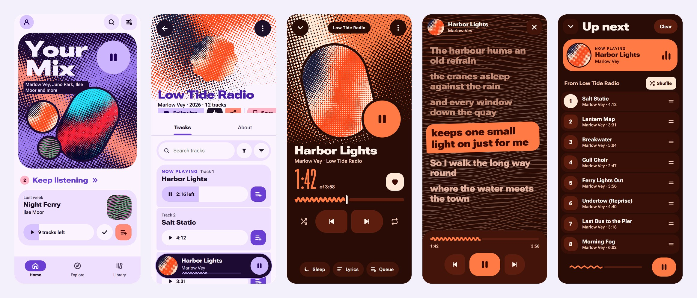
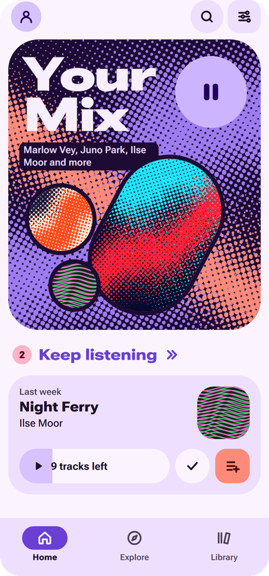
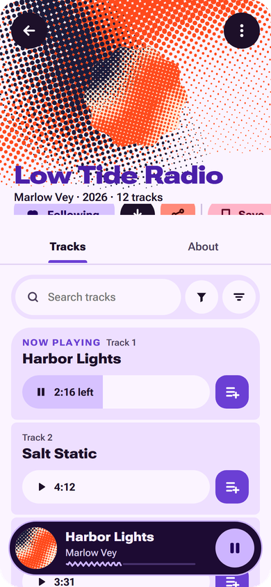
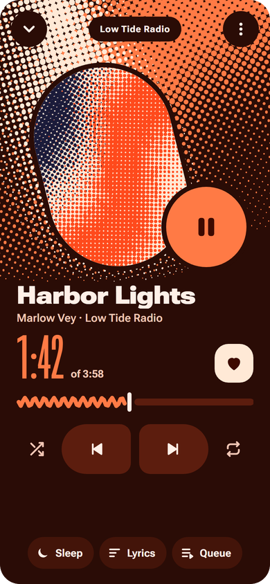
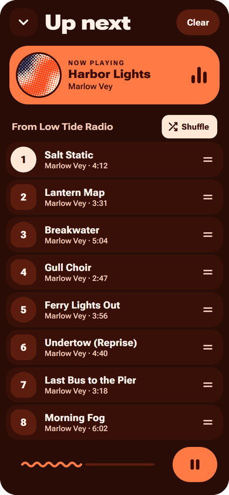
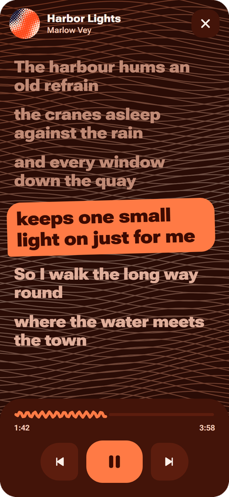
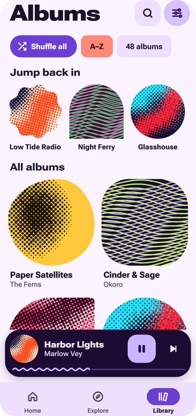
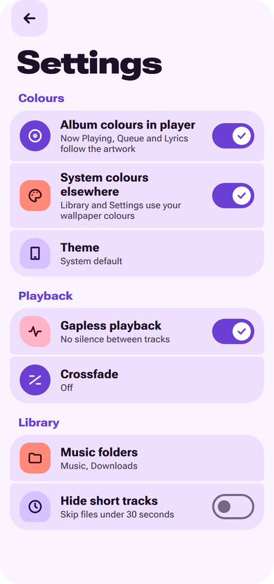

# M3spoti

[](LICENSE)
[](https://github.com/kota-zo/myspoti)

**A redesign of [Myspoti](https://github.com/kota-zo/myspoti), not the official app.** M3spoti is
Myspoti with a new UI: a Material 3 Expressive design built on halftone dot art. Every cover is
printed as two-ink dots or wavy lines and moves while music plays, set in wide Roboto Flex, in your
wallpaper colours, with album colours in the player, queue and lyrics.

I designed the UI and had Claude apply it to Myspoti. Everything underneath (playback, Spotify,
ad blocking, downloads, extensions) is Myspoti's work, unchanged. If you like the app, please
support [Myspoti's developer](#support).

<p align="center">
  
</p>
<p align="center"><sub>Design mockups with made-up music; the app follows them closely.</sub></p>

## What's different from Myspoti

- **Halftone covers everywhere.** Real covers become two-colour dots or wavy lines (whichever suits
  the picture), in shaped frames: cookies, pills, arches. They only animate while music plays, and
  never in battery saver or with animations turned off.
- **New screens:** Home, Explore, Library, album and playlist pages (with "Tracks | About" tabs),
  a new player with a morphing play button and a wavy progress bar, queue, lyrics and settings.
- **Two colour systems:** your wallpaper's colours (light or dark, as your phone) for the app, the
  playing cover's colours for the player, queue and lyrics.
- **Spotify links open in the app**: `open.spotify.com`, `spotify:` links, `spotify.link` short
  links and shared text.
- **Its own app ids** (`app.m3spoti`, `app.m3spoti.stable`, `app.m3spoti.dev`): it installs next to
  the official Myspoti instead of clashing with it.
- **New logo:** an M printed in dots.
- **Languages:** the new design is translated into all 11 of Myspoti's languages (English, German,
  French, Spanish, Italian, Portuguese, Brazilian Portuguese, Greek, Russian, Polish, Chinese).

| Home | Album | Player | Queue | Lyrics | Library | Settings |
|:---:|:---:|:---:|:---:|:---:|:---:|:---:|
|  |  |  |  |  |  |  |

## Status

A personal project, in beta. Signed APKs are on the [Releases](https://github.com/Didadavidi/myspoti-m3e-rebuild/releases)
page: `ARMv8` for almost every phone, `ARMv7` for older 32-bit ones, `universal` for both, `TV` for
Android TV (a preview of the TV design). Builds from the Releases page tell you in the app when a new one is out. M3spoti installs
next to the official [Myspoti](https://github.com/kota-zo/myspoti/releases/latest), as its own app.

## What Myspoti is

A Spotify app for Android that you install yourself. You sign in with your usual Spotify account
on Spotify's own login page, so the app never sees your password; a free account is enough. Under
the hood, the official Spotify Web Player plays the music, hidden inside the app, with your phone's
DRM; the app draws its own screens on top and drives it. Your plays count for the artists, in your
history and in your Wrapped.

What you get, all from Myspoti: no ads on a free account, Home, search, library, playlists
(create, edit, collaborative), podcasts and audiobooks, Spotify Connect and Jam, Android Auto,
word-by-word lyrics with translation, song meanings from Genius, official music videos, offline
downloads through extensions you install, an equalizer for downloaded and local songs, and your
own recap. The full list is in [Myspoti's README](https://github.com/kota-zo/myspoti#readme).

## Build and install

Requirements: JDK 21 and the Android SDK (compileSdk 37, `platforms;android-37.0`, `build-tools;36.0.0`).

```bash
cd base
./gradlew :app:assembleDebug -Pabis=arm64-v8a
```

The APK is in `base/app/build/outputs/apk/debug/` (Android 10 or later). A smaller, optimised build
under the same dev app: `./gradlew :app:assembleRelease -PoverDev -Pabis=arm64-v8a`. Both are signed
with the repo's public dev key (`base/app/dev-debug.keystore`), so a build from any machine installs
over the previous one.

Tests: `./gradlew :app:testDebugUnitTest`. Every push to `main` builds and tests on GitHub Actions.

The project layout (`:api`, `:api-spotify`, `:host-android`, `:host-cdp`, extensions) is Myspoti's;
see [`base/api-spotify/README.md`](base/api-spotify/README.md) and [`docs/api`](docs/api).

## Questions

**Is it safe for my account?** It talks to Spotify the way its web player does, and you sign in on
Spotify's own page. Blocking ads is still against Spotify's Terms of Use (see the disclaimer).

**Something broke?** Open an [issue here](https://github.com/Didadavidi/myspoti-m3e-rebuild/issues),
not on Myspoti, unless it also happens in the official app. Settings → **Export a diagnostic report**
gives the app's recent log and your phone's model, never your password or login tokens.

**What leaves my phone?** Your plays go to Spotify. Lyrics are looked up on lyrics sites, song
meanings on Genius, translations on Google Translate, music videos on YouTube, and downloads on the
hosts your download-source extension names. Nothing is sent to me or to Myspoti's developer.

## Not included

- No DRM circumvention, and no Spotify audio download: offline songs come from the download-source
  extension you install. The app ships no download source of its own.
- No ad is ever marked as heard.

## Disclaimer

Blocking ads goes against Spotify's Terms of Use, and Spotify may suspend accounts that do it. Use
this app at your own risk. If you can, support artists with Premium or by buying their music.

Not affiliated with or endorsed by Spotify or by Myspoti. Spotify is a trademark of Spotify AB.

## Support

The work in this app is Myspoti's. Support its developer on [Ko-fi](https://ko-fi.com/myspoti) or
[GitHub Sponsors](https://github.com/sponsors/kota-zo) (also from the profile menu in the app).

## Credits

- Based on [Myspoti](https://github.com/kota-zo/myspoti) (GPL-3.0) by kota-zo: everything but the design.
- **Design inspiration: [PixelPlayer](https://github.com/PixelPlayerHQ/PixelPlayer) by Theo Vilardo.** The shapes (the big rounded pills, the connected play/skip button group, the rounded cards) and the springy feel of the buttons are inspired by PixelPlayer. The halftone design on top is mine; Claude applied it to the code. None of PixelPlayer's code or assets are included, only the ideas.
- The Roboto Flex font file and the album-colour approach came from [PixelMusic](https://github.com/ianshulyadav/PixelMusic) (GPL-3.0) by Ian Shulyadav; no PixelMusic code or assets are included.
- UI derived from [Spotui](https://github.com/Spotui/Spotui) / [Metrolist](https://github.com/MetrolistGroup/Metrolist) (GPL-3.0); Spotui also gave the DASH-to-FLAC remux.
- Myspoti's Immersive look (still in the code, no longer shown) is ported from [BitChord](https://github.com/kushagrasinghx/BitChord) (GPL-3.0-or-later).
- [NewPipeExtractor](https://github.com/TeamNewPipe/NewPipeExtractor) (GPL-3.0): music videos.
- Lyrics: [LRCLIB](https://lrclib.net), LyricsPlus, lrc.red, Kugou and NetEase; song meanings: [Genius](https://genius.com).
- [Material Icons](https://github.com/google/material-design-icons) (Apache 2.0), the [Manrope](https://github.com/googlefonts/manrope) and [Roboto Flex](https://github.com/googlefonts/roboto-flex) fonts (SIL OFL 1.1, see `base/licenses/`).

Full notices: [`THIRD_PARTY_NOTICES.md`](THIRD_PARTY_NOTICES.md).

## License

GPL-3.0, as Myspoti. If you reuse this code, you must credit Myspoti, keep the license notices and
publish your complete source under GPL-3.0. See also [`AGENTS.md`](AGENTS.md).
